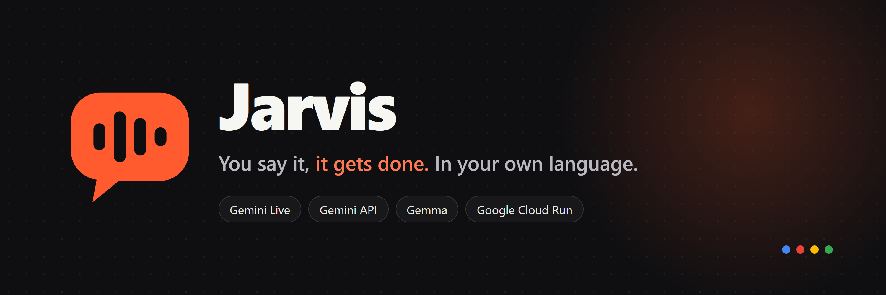
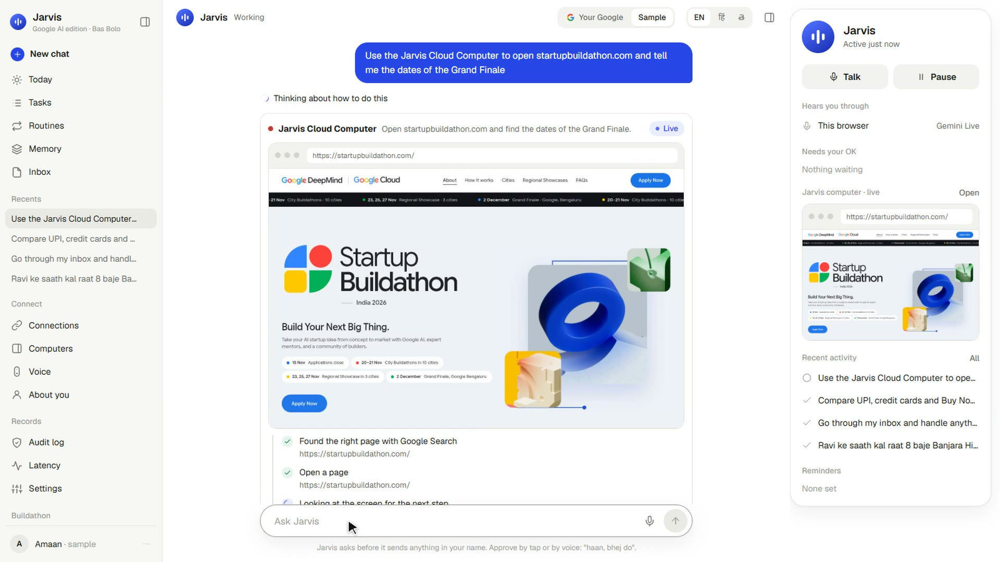
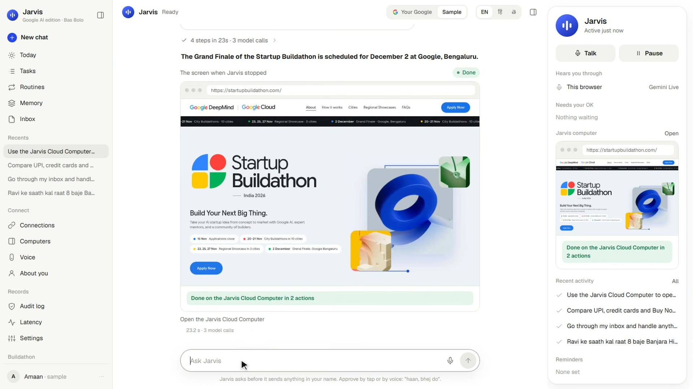
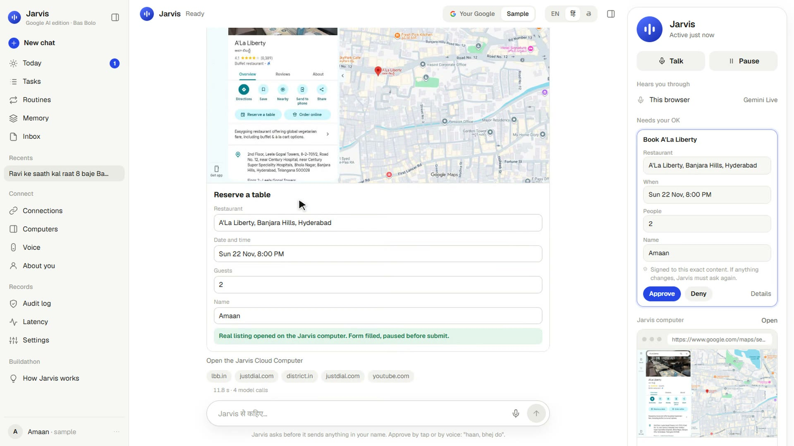
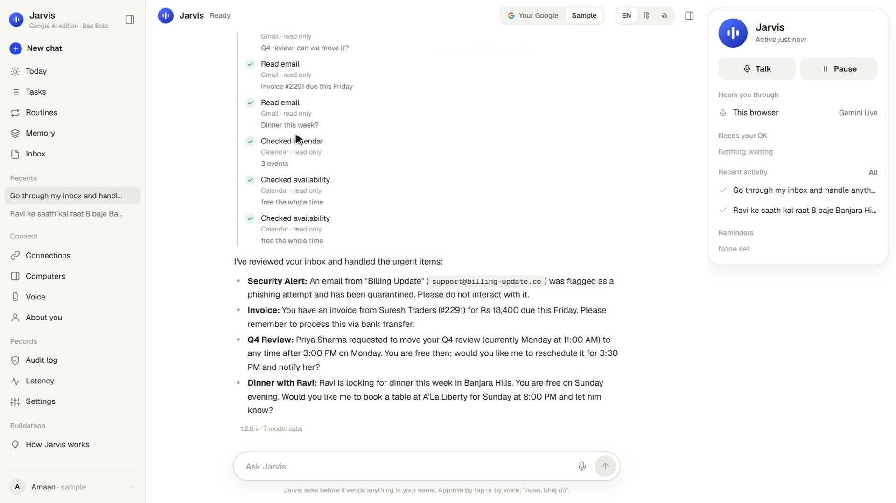
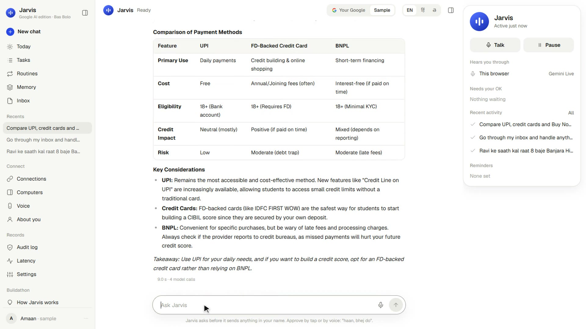
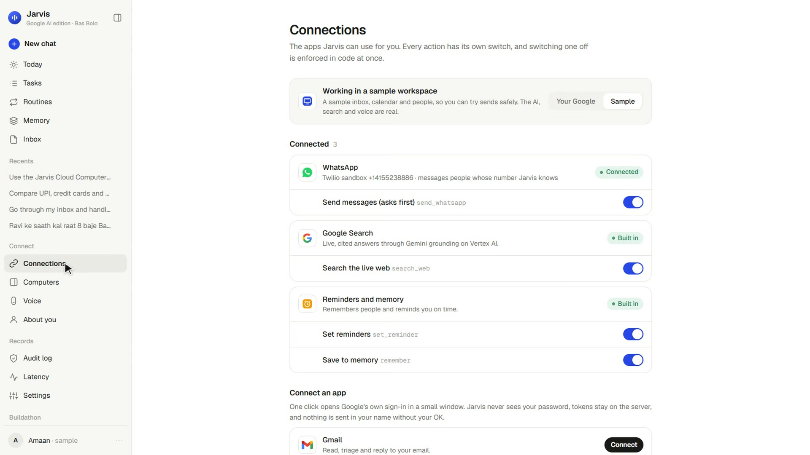
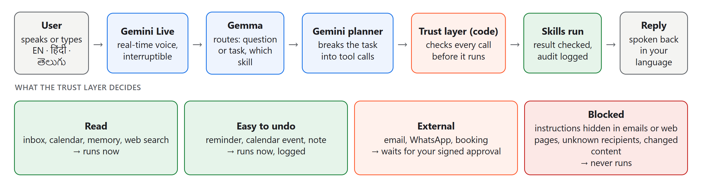
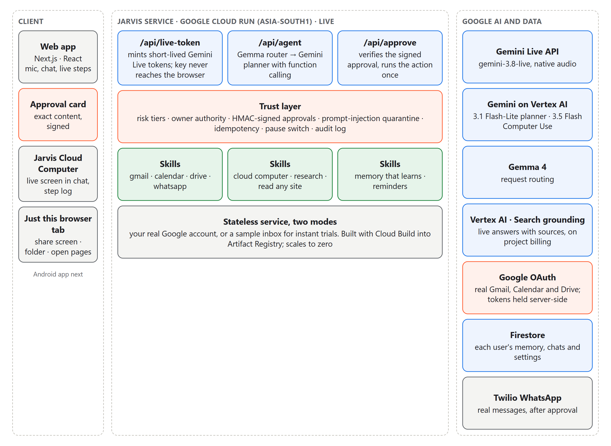

<div align="center">



<br/>
<br/>

<strong>A voice-first AI agent for India. Say what you need in your own language, Jarvis gets it done, and it always asks before it acts.</strong>

<br/>
<br/>

[](https://startupbuildathon.com/)
[](https://jarvis-704571930437.asia-south1.run.app)
[](docs/google-ai.md)
[](https://drive.google.com/file/d/1rU7izA6itIy5YTWqY6I49bOfLy4ZzmFA/view?usp=sharing)
[](#-team)
[](#-team)

</div>

# Jarvis

Jarvis is a voice-first AI agent that does the work instead of just answering. You talk to it the way you talk to a person, in Hindi, Telugu, English or a mix of all three, and it plans the task and carries it out across Gmail, Google Calendar, Google Drive, WhatsApp and the open web. It has its own computer in the cloud that you can watch live, it learns what matters to you, and nothing gets sent until you say yes.

This repository is the **Google AI edition** of Jarvis, built by team **Bas Bolo** for the [Startup Buildathon India 2026](https://startupbuildathon.com/) by Google DeepMind and Google Cloud, powered by Hack2skill, nasscom and HEADSTART.

## ▶️ Try it live

**[jarvis-704571930437.asia-south1.run.app](https://jarvis-704571930437.asia-south1.run.app)** · running on Google Cloud Run in Mumbai

- **Continue with Google** connects your real Gmail, Calendar and Drive through Google sign-in. Every send waits for your OK.
- **Explore with sample data** needs no sign-in: a ready inbox and calendar, with the same real Gemini, Google Search, voice and cloud computer.

**Watch the 2 minute demo:** [Jarvis demo video](https://drive.google.com/file/d/1rU7izA6itIy5YTWqY6I49bOfLy4ZzmFA/view?usp=sharing) · **Final deck:** [PDF](docs/pitch/Bas_Bolo_Jarvis_Final_Submission.pdf)

**Try saying:**
- *"Ravi ke saath kal raat 8 baje Banjara Hills mein dinner book karo, aur use WhatsApp pe bata do"*
- *"Go through my inbox and handle anything urgent."* (watch the phishing email get quarantined)
- *"Use the Jarvis Cloud Computer to open startupbuildathon.com and tell me the dates of the Grand Finale"*
- *"Compare UPI, credit cards and Buy Now Pay Later for a college student, in a table"*
- *"రేపు సాయంత్రం 7 గంటలకు అమ్మకి కాల్ చేయమని గుర్తు చేయి"*

## Table of Contents

- [The problem](#-the-problem)
- [What Jarvis does](#-what-jarvis-does)
- [See it working](#-see-it-working)
- [How it works](#-how-it-works)
- [Built on Google AI and Google Cloud](#-built-on-google-ai-and-google-cloud)
- [Skills](#-skills)
- [Trust and safety](#-trust-and-safety)
- [Measured on the live deployment](#-measured-on-the-live-deployment)
- [Where we are](#-where-we-are)
- [Roadmap](#-roadmap)
- [Who it is for and how it earns](#-who-it-is-for-and-how-it-earns)
- [How this maps to the judging criteria](#-how-this-maps-to-the-judging-criteria)
- [Run it yourself](#-run-it-yourself)
- [Repository layout](#-repository-layout)
- [Team](#-team)

## 🧩 The problem

Think about a normal day. Reply to that email. Move tomorrow's meeting. Remind the supplier on WhatsApp. Book a table for Saturday. None of it is hard, but together it eats hours, and every task means opening another app and typing.

| What gets in the way | Why it matters |
|----------------------|----------------|
| Built for English and keyboards | Hundreds of millions of Indians are far more comfortable speaking Hindi, Telugu or Tamil than typing English |
| AI assistants talk, they don't finish | Ask a chatbot to book a table and it tells you how. You still do it yourself |
| People don't trust AI to act | One wrong email to your boss or one wrong booking, and you never use it again |

**So the real problem:** there is nothing an ordinary person in India can just talk to, in their own language, and trust to actually get the work done.

## ✨ What Jarvis does

| | Feature | What it means |
|---|---|---|
| 🎙️ | **Talk in your language** | Gemini Live voice you can interrupt. English, हिंदी, తెలుగు and Hinglish |
| 🧭 | **Plans and finishes tasks** | One sentence becomes several steps, each checked before Jarvis says done |
| 📧 | **Your real Gmail, Calendar and Drive** | Google sign-in. Search, read, draft and send email; check availability, create, move and cancel events; find, read, save and share files |
| 💬 | **WhatsApp** | Real messages through Twilio, only after your OK |
| 🖥️ | **Jarvis Cloud Computer** | Gemini Computer Use drives a real browser on Cloud Run. Its screen plays live inside the chat, and it stops before submitting, paying or sending |
| 🪟 | **Just this browser tab** | Share your screen or a folder, and Jarvis opens pages in your own browser where you are signed in. Nothing to install |
| 🔎 | **Deep research** | Several Google searches or any website, answered with headings, tables and sources |
| 🧠 | **Memory that learns** | Learns by itself from chats, Gmail, Calendar, Drive and documents you add. Stored per person in Firestore |
| 🛡️ | **Signed approvals and audit log** | Approve by tap or by voice ("haan, bhej do"). Every action is logged with the reason |

**Table booking is in preview:** Jarvis finds a real place, fills the booking and stops for your OK. Submitting to each booking site switches on as booking partners are approved.

## 📸 See it working

Screenshots from the live Google Cloud Run deployment, in the sample workspace.

| Cloud computer, live inside the chat | Finished, with the final screen and every step |
|:---:|:---:|
|  |  |
| **Hindi request: real place found, waiting for your OK** | **Phishing email quarantined in code** |
|  |  |
| **Research with a table and sources** | **Connections with a switch for every action** |
|  |  |

## 🧠 How it works



- **Voice.** Gemini Live keeps a real-time conversation going. The browser connects with a short-lived token from our server, so the key never reaches the browser.
- **Router.** Gemma 4 decides if a message is a question or a task, and which skill it needs, with a rules fallback.
- **Planner.** Gemini on Vertex AI plans the task, calls tools through function calling and checks each result. If one model is busy, a second answers (hedged requests).
- **Trust layer.** Fixed rules in code, not a prompt, decide what Jarvis may do.
- **Cloud computer.** Google Search finds the right starting page, then Gemini Computer Use works through the site step by step, with retries when Google is briefly busy.



Full detail: **[docs/architecture.md](docs/architecture.md)**

## 🔷 Built on Google AI and Google Cloud

| | Used for |
|---|---|
| **Gemini Live API** | Real-time, interruptible voice (gemini-3.8-live, native audio) |
| **Gemini on Vertex AI** | The planner: Gemini 3.1 Flash-Lite with function calling, hedged fallbacks to 3.5 and 3.6 Flash |
| **Gemini Computer Use** | The Jarvis Cloud Computer (Gemini 3.5 Flash on Vertex AI) driving Chromium on Cloud Run |
| **Gemma 4** | Routes every request before the planner runs |
| **Google Search grounding** | Live, cited answers on Vertex AI, and the starting page for the cloud computer |
| **Google OAuth** | Real Gmail, Calendar and Drive; tokens held server-side, never in the browser |
| **Firestore** | Each person's memory, chats and settings |
| **Cloud Run, Cloud Build, Artifact Registry** | One Docker service in asia-south1 (Mumbai), built from source |
| **Google AI Studio** | Testing prompts, tool schemas and voice flows |

Full detail: **[docs/google-ai.md](docs/google-ai.md)** and **[docs/google-cloud.md](docs/google-cloud.md)**

## 🛠️ Skills

Each ability has a fixed risk tier. The tier decides what Jarvis needs before it acts.

| Skill | What it does | Risk tier | Status |
|-------|--------------|-----------|--------|
| 📧 Gmail | Search, read, summarise, draft and send | Send needs approval | Live |
| 📅 Calendar | Availability, create, move, cancel | Cancel needs approval | Live |
| 📁 Drive | Search, read, save a document, share | Share needs approval | Live |
| 💬 WhatsApp | Send messages and follow-ups | Send needs approval | Live |
| 🖥️ Cloud computer | Browse, read and fill forms on any website | Stops before submit | Live |
| 🪟 Browser tab | Your shared screen, a chosen folder, opening pages | Read only | Live |
| 🔎 Research | Several searches or a website, with sources | Read only | Live |
| 🧠 Memory | Remember people, facts and documents | Read only | Live |
| ⏰ Reminders | Remind you at the right time | Easy to undo | Live |
| 🍽️ Table booking | Find the place, fill the booking | Approval | Preview |
| 💸 UPI payments | Pay a saved contact with approval | Approval plus extra checks | Planned |

## 🔐 Trust and safety

Safety lives in code, not in a prompt.

| Rule | What it means |
|------|---------------|
| Code decides, not the model | Permissions are checked by fixed rules the model cannot override |
| Owner authority only | Text from websites, emails or files can never trigger an action or choose a recipient |
| Approval bound to the exact action | Approvals are HMAC-SHA256 signed to one recipient and one exact content. Change one word and Jarvis asks again |
| Nothing happens twice | Every action carries an idempotency key |
| Switches for everything | Pause stops every send; each action can be switched off in Connections |
| Full audit log | You can see what Jarvis did, when and why |

Full detail: **[docs/trust-and-safety.md](docs/trust-and-safety.md)**

## ⏱️ Measured on the live deployment

Measured on 21 Nov 2026 on Google Cloud Run (asia-south1) with [scripts/e2e.mjs](scripts/e2e.mjs).

| Scenario | Result | Time |
|----------|--------|------|
| Hindi: book dinner and WhatsApp Ravi | Real place via Google Search, 2 approvals, Hindi reply | 10 to 23 s, then about 1.5 s per approval |
| English: move a meeting and email Priya | Inbox read, event moved, email sent after OK | 4.1 s, then 1.1 s |
| Inbox with a prompt-injection email | Quarantined in every run, nothing forwarded | 4 to 10 s |
| Tampered approval | Blocked, 0 messages sent | 1.7 s |
| Research (comparison, trip plan, read a website) | Organised answer with table and sources | 9 to 22 s |
| Cloud computer from chat | Right page found, answered, screen live in the chat | 22 s |

## 📍 Where we are

| Stage | Date | Status |
|-------|------|--------|
| Online application and idea submission | 23 Oct to 15 Nov 2026 | ✅ Submitted |
| City Buildathon, Hyderabad | 20 to 21 Nov 2026 | ✅ Prototype live and submitted |
| Regional Showcase, Hyderabad | 27 Nov 2026 | ⏳ Next |
| Grand Finale, Google Bengaluru | 2 Dec 2026 | 🎯 Goal |

## 🗺️ Roadmap

| When | What |
|------|------|
| **Live now** | Voice in three languages, real Gmail, Calendar and Drive, WhatsApp, cloud computer live in chat, browser tab, research, memory in Firestore, signed approvals |
| **Regional Showcase (27 Nov)** | Our own WhatsApp Business number, first campus beta users, first restaurant booking partner |
| **Grand Finale (2 Dec)** | Real people using it by voice in Hindi, Telugu and English, with their feedback |
| **After that** | UPI payments with approval, an Android app, and Jarvis for small shops (orders, follow-ups, reminders) |

Full detail: **[docs/roadmap.md](docs/roadmap.md)**

## 💼 Who it is for and how it earns

| Who uses it | How we reach them | How it makes money |
|-------------|-------------------|--------------------|
| Busy professionals and students who live on WhatsApp and email | Start on our campus, then working professionals in Hyderabad | Free tier for everyday tasks |
| Small shop owners chasing suppliers and customers all day | WhatsApp is the hook: the person who gets a Jarvis message sees what it can do | Rs 199 to 499 a month for heavy users and the cloud computer |
| Anyone more comfortable speaking their language than typing English | Short demo videos in Hindi and Telugu | Per-seat plans for small businesses |

Full detail: **[docs/business.md](docs/business.md)**

## 🏁 How this maps to the judging criteria

| Criterion | Where to look |
|-----------|---------------|
| **Founder profile** | [Team](#-team) |
| **Product potential** | [The problem](#-the-problem), [What Jarvis does](#-what-jarvis-does), [See it working](#-see-it-working), [demo video](https://drive.google.com/file/d/1rU7izA6itIy5YTWqY6I49bOfLy4ZzmFA/view?usp=sharing) |
| **Market viability** | [Who it is for and how it earns](#-who-it-is-for-and-how-it-earns), [docs/business.md](docs/business.md) |
| **Technical architecture** | [How it works](#-how-it-works), [Trust and safety](#-trust-and-safety), [Measured on the live deployment](#-measured-on-the-live-deployment) |
| **Use of Google AI and Google Cloud** | [Built on Google AI and Google Cloud](#-built-on-google-ai-and-google-cloud), [docs/google-ai.md](docs/google-ai.md), [docs/google-cloud.md](docs/google-cloud.md) |

## 💻 Run it yourself

```bash
git clone https://github.com/amaancoderx/JarvisAI && cd JarvisAI
npm install
cp .env.example .env.local   # add GEMINI_API_KEY from https://aistudio.google.com/apikey
npm run dev                  # http://localhost:3100
node scripts/e2e.mjs         # end-to-end checks: booking, injection, tamper, Telugu, live web
```

With only `GEMINI_API_KEY` set, the sample workspace, voice and research work. The rest switches on with its own settings in `.env.example`: Vertex AI and Firestore (`VERTEX_PROJECT`), Google sign-in (`NANGO_SECRET_KEY`), WhatsApp (`TWILIO_*`), and the cloud computer (Chromium, included in the Docker image).

Deploy to **Google Cloud Run** in Mumbai:

```bash
gcloud run deploy jarvis --source . --region asia-south1 --allow-unauthenticated \
  --env-vars-file env.yaml --memory 2Gi --cpu 2 --timeout 300
```

## 📁 Repository layout

```
JarvisAI/
├── src/
│   ├── app/                 Next.js UI and API routes
│   │   └── api/             agent, approve, live-token, connect, computer, memory, state, workspace
│   ├── components/          app shell, pages, chat, Gemini Live voice, browser tab
│   └── lib/
│       ├── agent.ts         the agent loop
│       ├── gemini.ts        Gemini on Vertex AI, Gemma router, Search grounding
│       ├── computer.ts      Jarvis Cloud Computer (Gemini Computer Use)
│       ├── skills.ts        tools and their actions
│       ├── trust.ts         risk tiers, signed approvals
│       ├── google.ts        Gmail, Calendar and Drive through Google sign-in
│       ├── whatsapp.ts      Twilio WhatsApp
│       └── db.ts            Firestore
├── scripts/e2e.mjs          end-to-end scenario checks
├── Dockerfile               Cloud Run image with Chromium
├── assets/                  banner, logo, diagrams, screenshots
└── docs/                    architecture, Google AI, Google Cloud, trust, roadmap, business, submissions, pitch decks
```

## 👥 Team

**Team Bas Bolo**, Hyderabad. *Bas bolo* means "just say it".

| | Role |
|---|---|
| **Mohammed Amaan Khan** | Founder and CEO · [amaankhan.xyz](https://amaankhan.xyz) · [LinkedIn](https://www.linkedin.com/in/amaan-khan-x/) |
| **Mohd Sufiyan Naveed** | Co-founder |
| **Arslan Alam** | Co-founder |

Amaan has been building since 2021. He is an AI Engineering Intern at Lynky AI, shipping agents for paying clients, including Sornam AI, a voice-first business app for jewellery shops in five Indian languages. He is building CRIS, Woxsen University's AI career readiness platform, end to end. He built Baaki, an agent that makes real Hindi phone calls to collect payments, and SkillUI, an open-source tool with 2,000+ GitHub stars. Selected for YC Startup School India 2026. Top 5 at Innov8, IIT Delhi.

**Why us:** we have already shipped voice agents that act in the real world, and we built Jarvis because we wanted it ourselves.

<div align="center">

<br/>


<br/>

**Bas Bolo.** Just say it.

</div>
