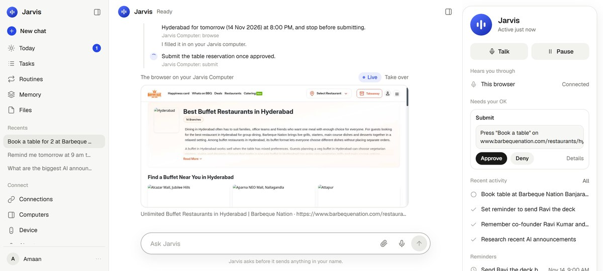
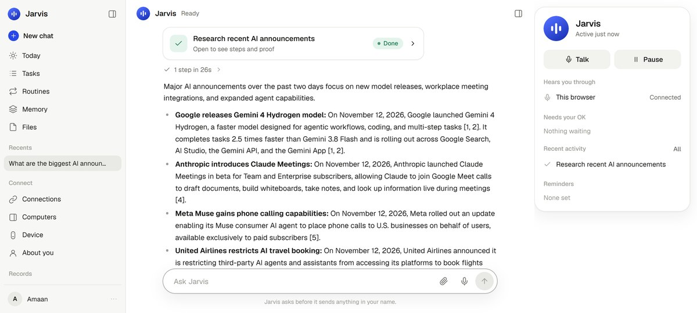
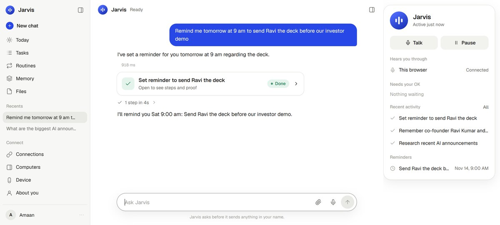
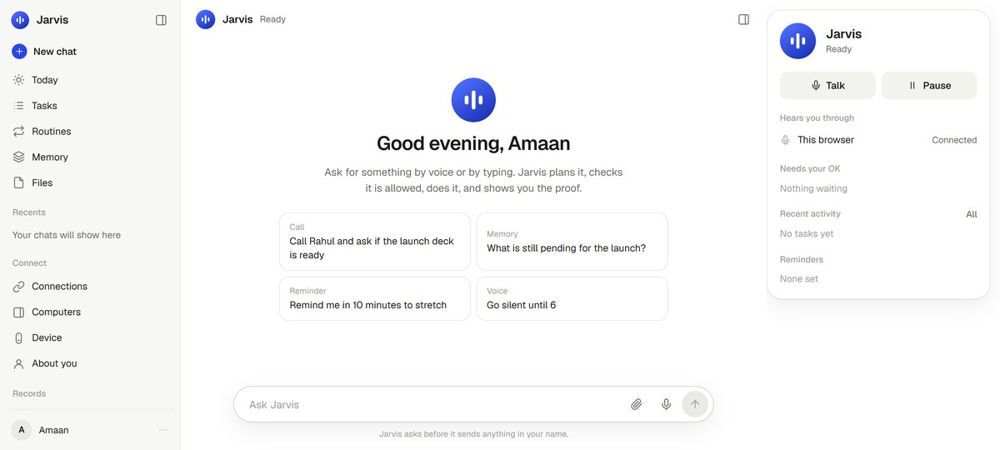
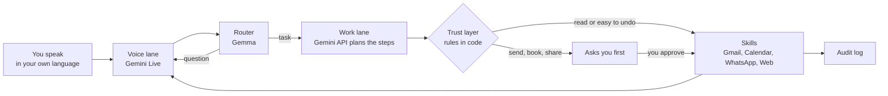

<div align="center">


<br/>
<br/>

<strong>A voice-first AI agent for India. Say what you need in your own language, Jarvis gets it done, and it always asks before it acts.</strong>

<br/>
<br/>

[](https://startupbuildathon.com/)
[](#-where-we-are)
[](docs/google-ai.md)
[](docs/google-cloud.md)
[](#-team)
[](#-team)

</div>

# Jarvis

Jarvis is a voice-first AI agent that does the work instead of just answering. You talk to it the way you talk to a person, in Hindi, Telugu, English or a mix of all three, and it plans the task and carries it out across Gmail, Google Calendar, WhatsApp and the open web. It has its own computer in the cloud, so it can open a website, fill a form and make a booking like a person would. It remembers the people and things that matter to you. And nothing gets sent or booked until you say yes.

This repository is the **Google AI edition** of Jarvis, built by team **Bas Bolo** at the [Startup Buildathon India 2026](https://startupbuildathon.com/) City Buildathon, Hyderabad, by Google DeepMind and Google Cloud, powered by Hack2skill, nasscom and HEADSTART.

## ▶️ Try it live

**[jarvis-ai-eight-swart.vercel.app](https://jarvis-ai-eight-swart.vercel.app)** · no sign-in needed

Tap a suggestion or press **Talk** and speak in English, Hindi or Telugu. The prototype runs on a **demo workspace** (sample inbox, calendar and contacts), so judges can try real sends and bookings safely: nothing leaves the sandbox. The AI is real: Gemini plans every task, Google Search grounding answers live questions, Gemini Live handles voice and Gemma routes requests.

**Try these:**
- *"Ravi ke saath kal raat 8 baje Banjara Hills mein dinner book karo, aur use WhatsApp pe bata do"*
- *"Go through my inbox and handle anything urgent."* (watch the phishing email get quarantined)
- *"రేపు సాయంత్రం 7 గంటలకు అమ్మకి కాల్ చేయమని గుర్తు చేయి"*
- *"What are the biggest AI announcements this week?"*

## Table of Contents

- [The problem](#-the-problem)
- [What Jarvis does](#-what-jarvis-does)
- [See it working](#-see-it-working)
- [How it works](#-how-it-works)
- [Built on Google AI](#-built-on-google-ai)
- [Skills](#-skills)
- [Trust and safety](#-trust-and-safety)
- [Deploying on Google Cloud](#-deploying-on-google-cloud)
- [Where we are](#-where-we-are)
- [Roadmap](#-roadmap)
- [Who it is for and how it earns](#-who-it-is-for-and-how-it-earns)
- [How this maps to the judging criteria](#-how-this-maps-to-the-judging-criteria)
- [Repository layout](#-repository-layout)
- [Team](#-team)

## 🧩 The problem

Think about a normal day. Reply to that email. Move tomorrow's meeting. Remind the supplier on WhatsApp. Book a table for Saturday. None of it is hard, but together it eats hours, and every task means opening another app and typing.

| What gets in the way | Why it matters |
|----------------------|----------------|
| Built for English and keyboards | Hundreds of millions of Indians are far more comfortable speaking Hindi, Telugu or Tamil than typing English |
| AI assistants talk, they don't finish | Ask a chatbot to book a table and it tells you how. You still do it yourself |
| People don't trust AI to act | One wrong email to your boss or one wrong booking, and you never use it again |

**So the real problem:** there is nothing an ordinary person in India can just talk to, in their own language, and trust to actually get the work done.

## ✨ What Jarvis does

- **Talk normally, in your language.** Jarvis breaks the request into steps and works through them.
- **Works inside the apps you already use.** Gmail, Google Calendar, WhatsApp and any website.
- **Has its own computer in the cloud.** It opens sites, fills forms and makes bookings like a person would.
- **Remembers people and past chats.** "Tell Ravi" just works.
- **Always asks first.** Nothing is sent or booked until you approve, and you can see everything it did.

**A request it handles today:** *"Book a table for 4 tonight and tell Ravi."* Jarvis finds the place, fills the booking, shows it to you, and only books and messages Ravi after you approve.

## 📸 See it working

Real screenshots from the version of Jarvis running today.

| Booking on its own cloud computer, paused for approval | A researched answer with live steps |
|:---:|:---:|
|  |  |
| **Remembering what matters** | **Home** |
|  |  |

## 🧠 How it works

Jarvis runs on **two lanes**, so it never goes quiet while it works.



- **Voice lane.** Gemini Live keeps a real-time conversation going. You can interrupt it like a person.
- **Router.** Gemma, a small fast model, decides if a message is a question or a task, and which skill it needs.
- **Work lane.** The Gemini API plans the task, calls tools through function calling, and checks each result before saying "done".
- **Trust layer.** Fixed rules in code, not a prompt, decide what Jarvis may do.
- **Cloud computer.** An isolated browser that moves through real websites and stops for your OK before it submits anything.

Full detail: **[docs/architecture.md](docs/architecture.md)**

## 🔷 Built on Google AI

| | Used for | Why |
|---|---|---|
| **Gemini Live** | The voice: real-time, interruptible conversation in Hindi, English and other Indian languages | Makes Jarvis feel like talking to a person, not filling a form |
| **Gemini API** | The brain: understanding, planning, function calling, checking results | Strong tool calling and long context for memory |
| **Gemma** | The router: sorts each message before the big model runs | Keeps Jarvis fast and affordable at scale, and opens a path to on-device privacy |
| **Google AI Studio** | Testing planner prompts, tool definitions and Gemini Live voice flows | Fast iteration before anything reaches users |
| **Google Antigravity** | Building each new integration | A small team can add new apps quickly |
| **Google Agent Skills** | Every ability is its own skill, loaded only when a task needs it | Keeps the core agent small and predictable |

Full detail: **[docs/google-ai.md](docs/google-ai.md)**

## 🛠️ Skills

Each ability is a separate skill with a fixed risk tier. The tier decides what Jarvis needs before it acts.

| Skill | What it does | Risk tier | Status |
|-------|--------------|-----------|--------|
| 📧 `gmail` | Read, summarise, draft and send email | Send needs approval | Working today |
| 📅 `calendar` | Check, create and move events | Easy to undo | Working today |
| 💬 `whatsapp` | Send messages and follow-ups | Send needs approval | Working today |
| 🌐 `web-computer` | Browse, fill forms and book on any website | Submit needs approval | Working today |
| ⏰ `reminders` | Remind you at the right time | Easy to undo | Working today |
| 🔎 `research` | Search the web and answer with sources | Read only | Working today |
| 🧠 `memory` | Remember people, facts and past chats | Read only | Working today |
| 💸 `upi-payments` | Pay a saved contact with approval | Approval plus extra checks | Planned |

## 🔐 Trust and safety

Safety lives in code, not in a prompt.

| Rule | What it means |
|------|---------------|
| Code decides, not the model | Permissions are checked by fixed rules the model cannot override |
| Owner authority only | Text from websites, emails or files can never trigger an action on its own |
| Approval bound to the exact action | An approval covers one recipient and one exact content. If either changes, Jarvis asks again |
| Nothing happens twice | Every action carries an idempotency key, and an unclear send is verified before any retry |
| Pause everything | One switch stops all actions instantly |
| Full audit log | You can see what Jarvis did, when and why |

Full detail: **[docs/trust-and-safety.md](docs/trust-and-safety.md)**

## ☁️ Deploying on Google Cloud

| Service | Role |
|---------|------|
| **Cloud Run** | Voice lane, work lane and cloud computer run as separate services that scale on their own |
| **Cloud SQL (PostgreSQL)** | Memory, tasks and approvals |
| **Cloud Storage** | Action log, audit trail and screenshots |
| **Pub/Sub** | Long-running tasks, so the voice conversation never waits |
| **Cloud Scheduler** | Reminders and routines |
| **Secret Manager** | API keys and connected-account tokens |

Region: **asia-south1 (Mumbai)** for low latency in India. Browser sessions scale to zero when idle to keep costs low.

Full detail: **[docs/google-cloud.md](docs/google-cloud.md)**

## 📍 Where we are

| Stage | Date | Status |
|-------|------|--------|
| Online application and idea submission | 23 Oct to 15 Nov 2026 | ✅ Submitted |
| City Buildathon, Hyderabad | 20 to 21 Nov 2026 | 🔨 Building now |
| Regional Showcase, Hyderabad | 27 Nov 2026 | ⏳ Next |
| Grand Finale, Google Bengaluru | 2 Dec 2026 | 🎯 Goal |

## 🗺️ Roadmap

| When | What |
|------|------|
| **Working now** | Voice and chat, Gmail, Calendar, WhatsApp, web booking with approval, memory |
| **City Buildathon (20 to 21 Nov)** | Build the Google AI edition: Gemini Live voice, Gemini API planning, Gemma routing, deployed on Cloud Run, demoed live to the jury |
| **Grand Finale (2 Dec)** | Real people using it, not just a demo. Full tasks by voice in Hindi, Telugu and English, live on Google Cloud, with first beta users on campus and their feedback |
| **After that** | UPI payments with approval, an Android app, and Jarvis for small shops (orders, follow-ups, reminders) |

Full detail: **[docs/roadmap.md](docs/roadmap.md)**

## 💼 Who it is for and how it earns

| Who uses it | How we reach them | How it makes money |
|-------------|-------------------|--------------------|
| Busy professionals and students who live on WhatsApp and email | Start on our campus, then working professionals in Hyderabad | Free tier for everyday tasks |
| Small shop owners chasing suppliers and customers all day | WhatsApp is the hook: see a task done, invite a friend | Rs 199 to 499 a month for heavy users and the cloud computer |
| Anyone more comfortable speaking their language than typing English | Short demo videos in Hindi and Telugu | Per-seat plans for small businesses |

Full detail: **[docs/business.md](docs/business.md)**

## 🏁 How this maps to the judging criteria

| Criterion | Where to look |
|-----------|---------------|
| **Founder profile** | [Team](#-team) |
| **Product potential** | [The problem](#-the-problem), [What Jarvis does](#-what-jarvis-does), [See it working](#-see-it-working) |
| **Market viability** | [Who it is for and how it earns](#-who-it-is-for-and-how-it-earns), [docs/business.md](docs/business.md) |
| **Technical architecture** | [How it works](#-how-it-works), [docs/architecture.md](docs/architecture.md), [docs/trust-and-safety.md](docs/trust-and-safety.md) |
| **Use of Google AI** | [Built on Google AI](#-built-on-google-ai), [docs/google-ai.md](docs/google-ai.md), [docs/google-cloud.md](docs/google-cloud.md) |

## 💻 Run it yourself

```bash
git clone https://github.com/amaancoderx/JarvisAI && cd JarvisAI
npm install
cp .env.example .env.local   # add GEMINI_API_KEY from https://aistudio.google.com/apikey
npm run dev                  # http://localhost:3100
node scripts/e2e.mjs         # end-to-end checks: booking, injection, tamper, Telugu, live web
```

Deploy to **Google Cloud Run** (Mumbai):

```bash
gcloud run deploy jarvis --source . --region asia-south1 --allow-unauthenticated   --set-env-vars GEMINI_API_KEY=...,APPROVAL_SECRET=...
```

## 📁 Repository layout

```
JarvisAI/
├── src/
│   ├── app/                 Next.js UI and API routes (/api/agent, /api/approve, /api/live-token)
│   ├── components/          App shell, Gemini Live voice client
│   └── lib/                 agent loop, Gemini + Gemma, skills, trust layer, demo workspace
├── scripts/e2e.mjs          end-to-end scenario checks
├── Dockerfile               Cloud Run image
├── assets/
│   ├── banner.png
│   ├── logo.png
│   ├── prototype/           screenshots of this prototype
│   └── screenshots/         screenshots of Jarvis in production
└── docs/
    ├── architecture.md
    ├── google-ai.md
    ├── google-cloud.md
    ├── trust-and-safety.md
    ├── roadmap.md
    ├── business.md
    ├── submission.md
    └── pitch/
        └── Bas_Bolo_Jarvis_Idea_Submission.pdf
```

The planned code layout for the build is in [docs/architecture.md](docs/architecture.md#planned-code-layout).

## 👥 Team

**Team Bas Bolo**, Hyderabad. *Bas bolo* means "just say it".

| | Role |
|---|---|
| **Mohammed Amaan Khan** | Founder and CEO |
| **Mohd Sufiyan Naveed** | Co-founder |
| **Arslan Alam** | Co-founder |

Amaan has been building since 2021. He is an AI Engineering Intern at Lynky AI, building agents for paying clients, and at Woxsen University's Centre of Talent Development, building its AI career readiness platform end to end. He built Baaki, an agent that makes real Hindi phone calls to collect payments, and SkillUI, an open-source tool with 2,000+ GitHub stars. Selected for YC Startup School India 2026. Top 5 at Innov8, IIT Delhi.

**Why us:** we have already shipped voice agents that act in the real world, and we built Jarvis because we wanted it ourselves.

<div align="center">

<br/>


<br/>

**Bas Bolo.** Just say it.

</div>
