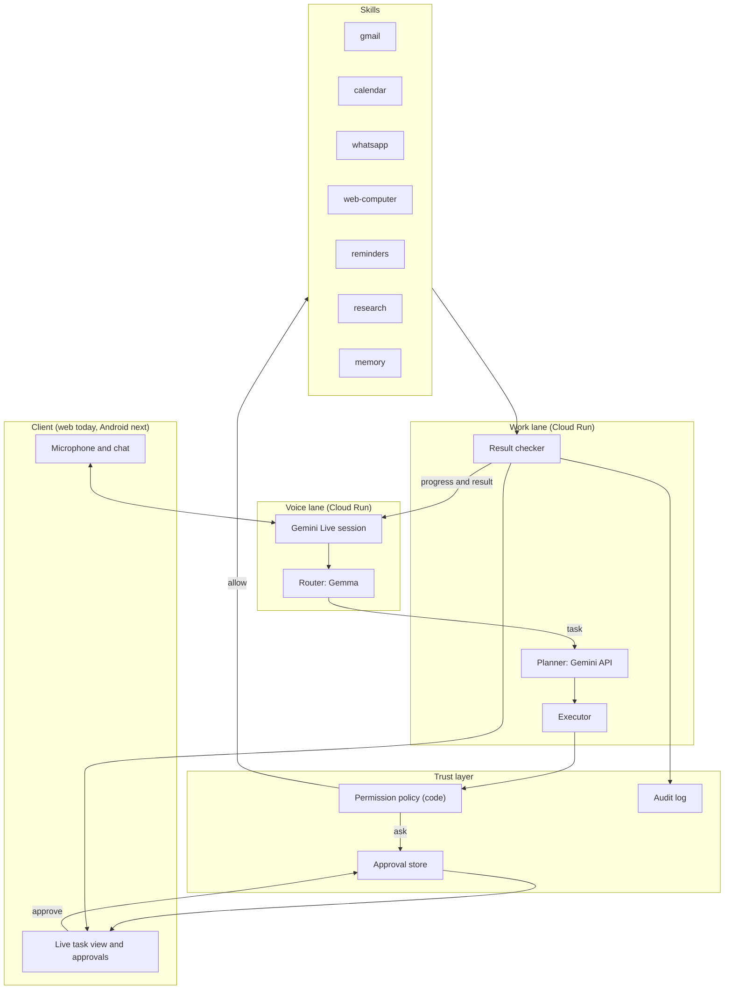
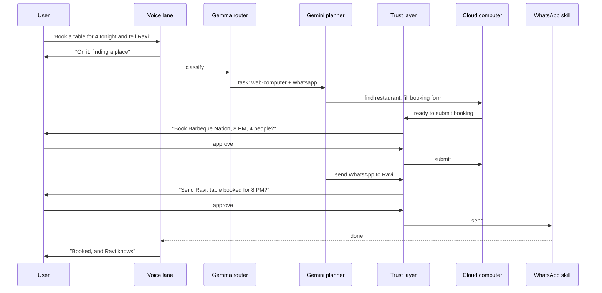

# Architecture

[Back to README](../README.md)

This is the architecture of the Google AI edition of Jarvis. It keeps the design that already works in production and moves the AI and the hosting onto Gemini and Google Cloud.

**Built today:** one Next.js service on Cloud Run with Gemini on Vertex AI, Gemini Computer Use, Gemma, Search grounding and Firestore. See the [architecture diagram](../assets/architecture.png). Where this page describes Pub/Sub, a separate services layout or a SQL database, that is the planned shape as Jarvis grows.

## Design goals

1. **Never go quiet.** The user should always hear something within a second, even while a long task runs.
2. **Finish the task.** Plan, act and check, not just answer.
3. **Never surprise the user.** Anything that leaves their account waits for a yes.
4. **Stay cheap at scale.** Use the big model only when it is needed.

## The two lanes



### Voice lane

- Holds one **Gemini Live** session per conversation, streaming audio both ways over WebSockets.
- Speaks short acknowledgements right away ("Looking for a table now") so the user is never left waiting.
- Hands each message to the **router** first.

### Router

- **Gemma** classifies each message: plain question, or task that needs action. If it is a task, it names the skill.
- Plain questions are answered in the voice lane. Tasks go to the work lane.
- This keeps the expensive model for the work that needs it.

### Work lane

- **Planner.** The Gemini API turns the request into a short list of steps, each one a structured tool call that is checked against a schema. Free-form actions are rejected.
- **Executor.** Runs each step through the trust layer, then through the skill.
- **Result checker.** Confirms each step actually worked (the email shows as sent, the event exists) before Jarvis says "done".
- Long tasks will run through **Pub/Sub** (planned), so the voice lane keeps talking while the work happens.

### Trust layer

Covered in full in [trust-and-safety.md](trust-and-safety.md). In short: fixed rules in code decide what is allowed, and every external action needs an approval bound to its exact recipient and content.

### Cloud computer

- A headless Chromium browser on Cloud Run, one session per person, driven by Gemini Computer Use.
- Navigates real websites, fills forms, and **stops before the final submit** to ask for approval.
- Streams a live view into the chat so the user can watch it work.
- Shuts down when idle.

### Memory

- People, facts, documents and past conversations, stored per person in **Firestore**. It learns by itself from chats, Gmail, Calendar, Drive and documents the user adds.
- Each chat has its own short-term context; long-term memory is shared across chats.
- Gemini's long context lets the planner use relevant memory without extra lookups.

## A task, end to end



## Planned code layout

To be built during the City Buildathon:

```
JarvisAI/
├── apps/
│   └── web/                 Next.js client: voice, chat, live task view, approvals
├── services/
│   ├── voice/               Gemini Live session, Gemma router
│   ├── work/                Gemini planner, executor, result checker
│   └── computer/            isolated browser for web tasks
├── packages/
│   ├── trust/               permission policy, approvals, audit log
│   ├── skills/              gmail, calendar, whatsapp, web-computer, reminders, research, memory
│   └── schemas/             shared tool-call and event schemas
├── infra/                   Cloud Run, Cloud SQL, Pub/Sub, Scheduler setup
└── docs/
```

## Tech stack

| Layer | Choice |
|-------|--------|
| Language | TypeScript |
| Client | Next.js |
| Services | Node.js on Cloud Run |
| Realtime | Gemini Live over WebSockets |
| AI | Gemini Live, Gemini on Vertex AI, Gemini Computer Use, Gemma, Search grounding |
| Data | Firestore today; Cloud Storage planned |
| Queues and jobs | Pub/Sub and Cloud Scheduler (planned) |
| Packaging | Docker containers |
