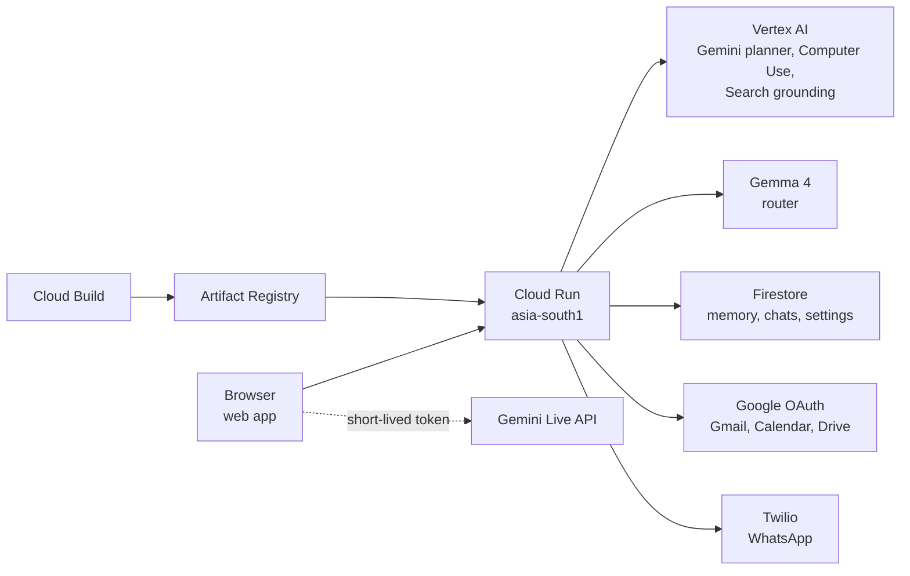

# Deploying on Google Cloud

[Back to README](../README.md)

Jarvis is live on Google Cloud Run in Mumbai: **[jarvis-704571930437.asia-south1.run.app](https://jarvis-704571930437.asia-south1.run.app)**

## What runs today



| Service | Role |
|---------|------|
| **Cloud Run** | One Docker service: the web app, the API and the Jarvis Cloud Computer (Chromium driven by Gemini Computer Use) |
| **Vertex AI** | Gemini planner with function calling, Gemini Computer Use, and Google Search grounding, billed to the project using Cloud Run's own identity (no key in the code) |
| **Firestore** | Each person's memory, chats and settings |
| **Cloud Build and Artifact Registry** | Build the image from source on every deploy |
| **Gemini Live API** | Voice; the server mints a short-lived token so the key never reaches the browser |

Region: **asia-south1 (Mumbai)** for low latency in India. Cloud Run scales with demand, and idle cloud-computer sessions close after 10 minutes.

## Deploy

```bash
gcloud run deploy jarvis --source . --region asia-south1 --allow-unauthenticated \
  --env-vars-file env.yaml --memory 2Gi --cpu 2 --timeout 300
```

The service account needs `aiplatform.user` (Vertex AI) and `datastore.user` (Firestore).

## Next on Google Cloud

| Service | Why |
|---------|-----|
| **Secret Manager** | Move keys out of environment variables |
| **Pub/Sub** | Run long tasks in the background so voice never waits |
| **Cloud Scheduler** | Routines and reminders that fire on time without the app open |
| **Cloud Storage** | Keep task screenshots and the audit trail long term |
