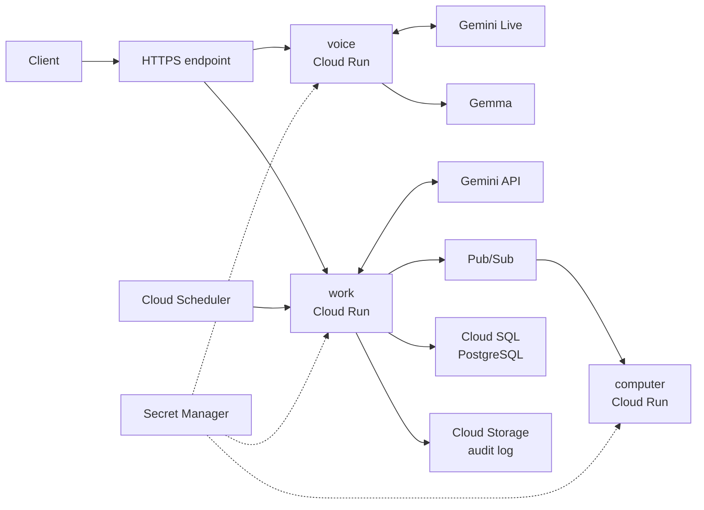

# Deploying on Google Cloud

[Back to README](../README.md)

Every Jarvis service is already a Docker container, so it moves straight onto Cloud Run.

## Services

| Service | Role |
|---------|------|
| **Cloud Run: voice** | Gemini Live sessions and Gemma routing |
| **Cloud Run: work** | Planner, executor, trust layer, skills |
| **Cloud Run: computer** | Isolated browser sessions for web tasks, scale to zero when idle |
| **Cloud SQL (PostgreSQL)** | Memory, tasks, approvals |
| **Cloud Storage** | Action log, audit trail, task screenshots |
| **Pub/Sub** | Queue for long-running tasks, so the voice conversation never waits |
| **Cloud Scheduler** | Reminders and routines |
| **Secret Manager** | API keys and connected-account tokens |
| **Cloud Logging and Monitoring** | Errors, latency and cost tracking |

## Region

**asia-south1 (Mumbai)**, for low latency for users in India.

## Scaling

- The voice, work and computer services scale independently, so a spike in web tasks does not slow down conversation.
- Browser sessions are the most expensive part, so they run as separate containers that start per task and scale to zero.
- Gemma routing keeps most simple messages away from the larger model.

## Deployment steps (buildathon)

1. Create the project and enable Cloud Run, Cloud SQL, Pub/Sub, Scheduler, Secret Manager and the Gemini API.
2. Create the Cloud SQL instance and run the schema.
3. Store keys and tokens in Secret Manager.
4. Build and deploy the `voice`, `work` and `computer` containers to Cloud Run in asia-south1.
5. Point the web client at the services and run the end-to-end demo.
