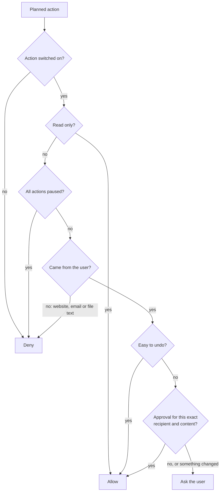

# Trust and safety

[Back to README](../README.md)

An agent that sends email and books things for you is only useful if you trust it completely. In Jarvis, safety lives in code, not in a prompt.

## Risk tiers

Every skill action has a fixed tier, set in code.

| Tier | Examples | What Jarvis needs |
|------|----------|-------------------|
| **Read** | Read inbox, check calendar, research, recall memory | Nothing extra |
| **Easy to undo** | Add a calendar event, set a reminder | Request must come from the user |
| **External** | Send an email or WhatsApp, submit a booking | Your approval, bound to the exact recipient and content |

## How a decision is made

## The rules

1. **Code decides, not the model.** The planner suggests actions. A deterministic policy decides whether they run.
2. **Only the owner has authority.** Text that came from a website, an email or a file can never start an action on its own. This blocks prompt injection.
3. **Approvals are bound to the exact action.** An approval covers one recipient and a hash of the exact content. If either changes, Jarvis asks again.
4. **Nothing happens twice.** Every external action carries an idempotency key. If a send is uncertain, Jarvis checks whether it went through before retrying.
5. **One switch pauses everything.** The user can stop all actions instantly.
6. **Everything is logged.** Every action is written to an audit log with what was done, when and why.

## The cloud computer

- Each web task runs in its own isolated browser container.
- It stops before the final submit on any form and asks for approval.
- The user can watch it live and take over at any time.
- Sign-ins are never typed by Jarvis without the user present.

## Privacy

- Connected-account tokens are stored in Secret Manager, never in logs.
- Memory belongs to the user and can be viewed and deleted.
- Designed with India's DPDP Act in mind: clear purpose, user control and deletion.
